# Lab 2 Notes

The folder structure prepared for this lab is shown below.
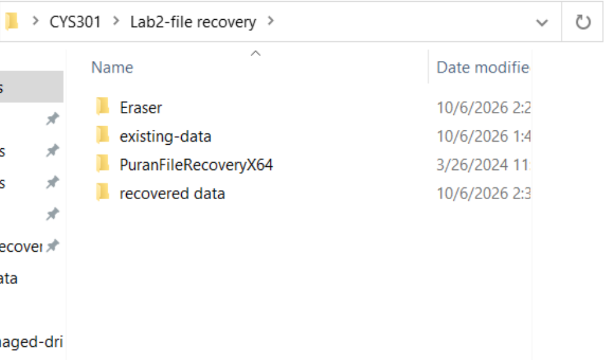   
The goal of this lab is to restore files after a normal deletion.
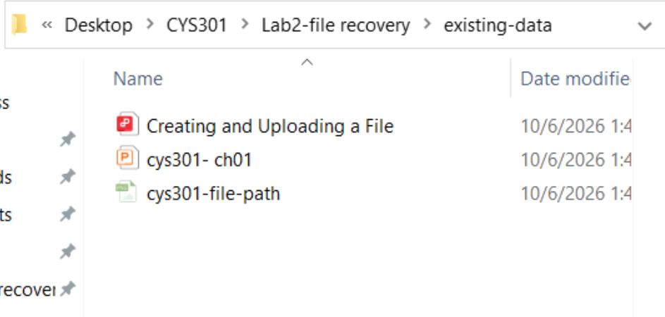

## Using Eraser
After installation, open the software and choose **New Task** from the arrow menu in the upper-left corner (or press **Ctrl+N**).
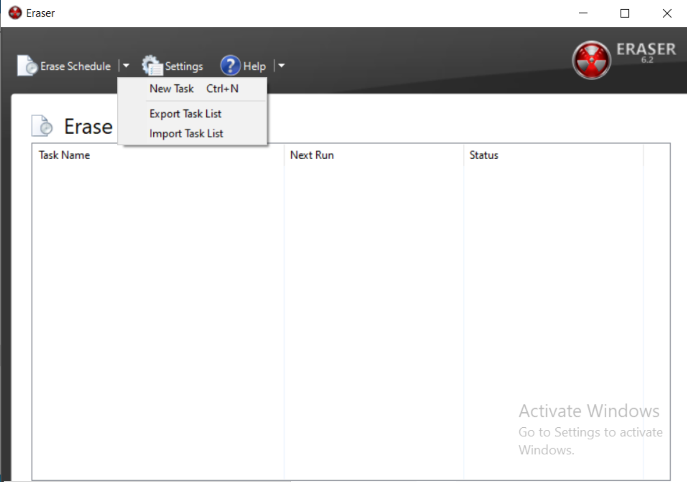

Configure Task Properties:
  - Enter a Task name (optional); the value shown here is an example.
  - Choose a **Task Type**:
    - Run immediately
    - Run manually
    - Run on restart: run when the computer restarts. If a file is in use or locked, the task can run automatically during shutdown.
    - Recurring: run automatically on a schedule that you configure.
  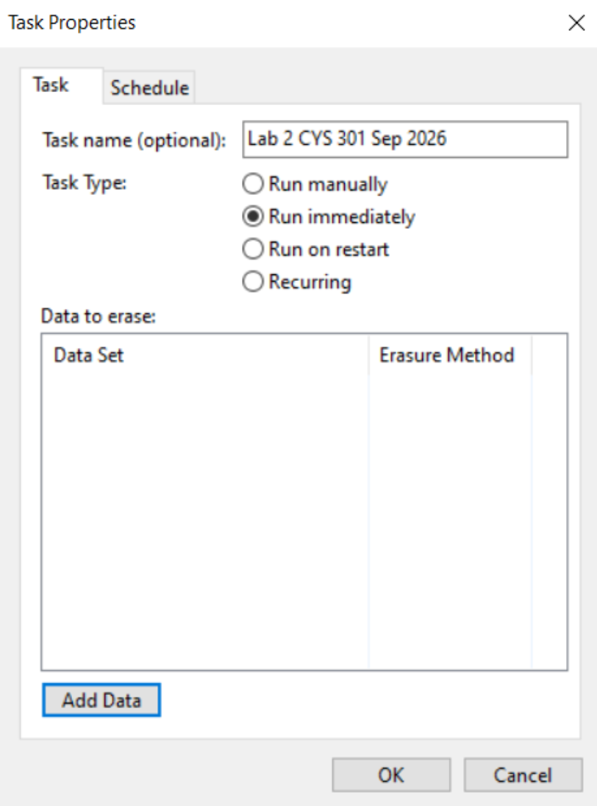

  - Select **Add Data** in the lower-left corner, then choose a **target type**.
    - **File** and **Files in Folder** behave differently: File erases only the selected file, while Files in Folder erases all contents inside the selected folder but leaves the folder itself.
    - **Recycle Bin**: securely empties the Windows Recycle Bin using the selected security standard. It is often paired with a recurring schedule.
    - **Unused disk space**: erases the remaining space on a partition marked as deleted but not yet overwritten. With an ordinary delete, the underlying data may still be recoverable by recovery software.
    - **Secure move**: securely moves a file or folder to a new location and destroys residual data at the old location.
    - **Drive/Partition**: erases all contents on an entire drive or a selected partition. The original notes state that data cannot be recovered afterward.
  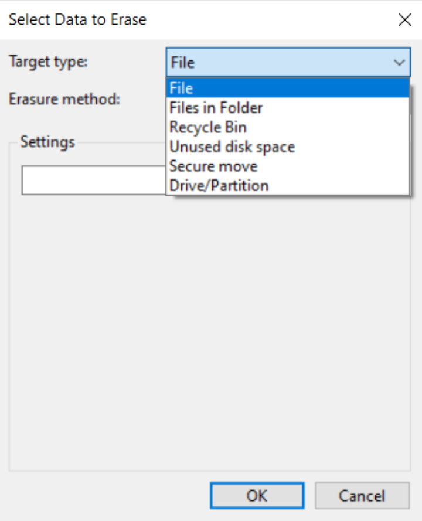

  - Choose an **Eraser method**.
    - This lab uses the *US DoD* standard mentioned in class. It overwrites data three or seven times, writing zeros, ones, and then random data, followed by verification. It offers a high level of security at a moderate speed and is recommended here for traditional hard disk drives (HDDs).
    - Another option is *Pseudorandom Data*. It overwrites data once with random data and is very fast. The original notes recommend it for solid-state drives (SSDs) or routine quick cleanup.
    - To check the default, open **Settings > Erase Settings > Default file eraser method**. The default on my system is Gutmann, an older, intensive method that may cause additional drive wear.
  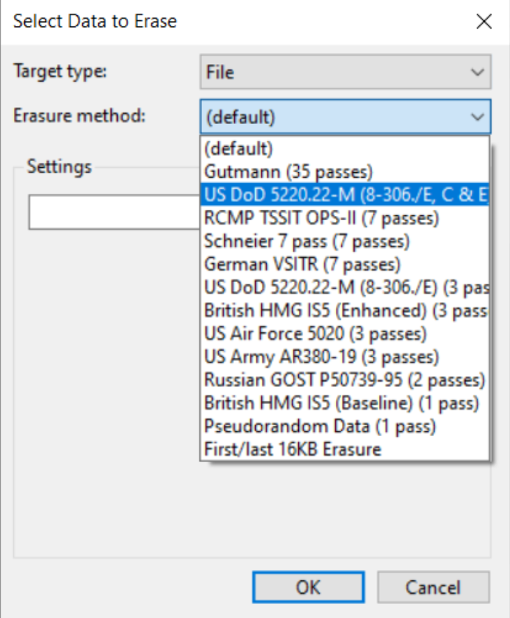

After adding the data, start the erasure task.
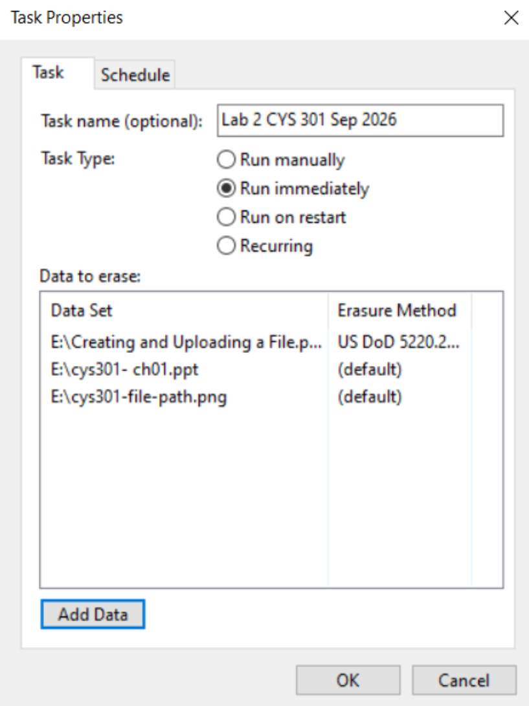

## Using Puran File Recovery

### Normal deletion without Eraser
Prepare the files on the drive.
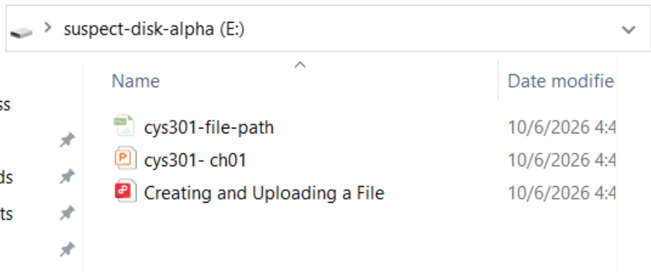

Open the software and select the **suspect-disk-alpha** drive.
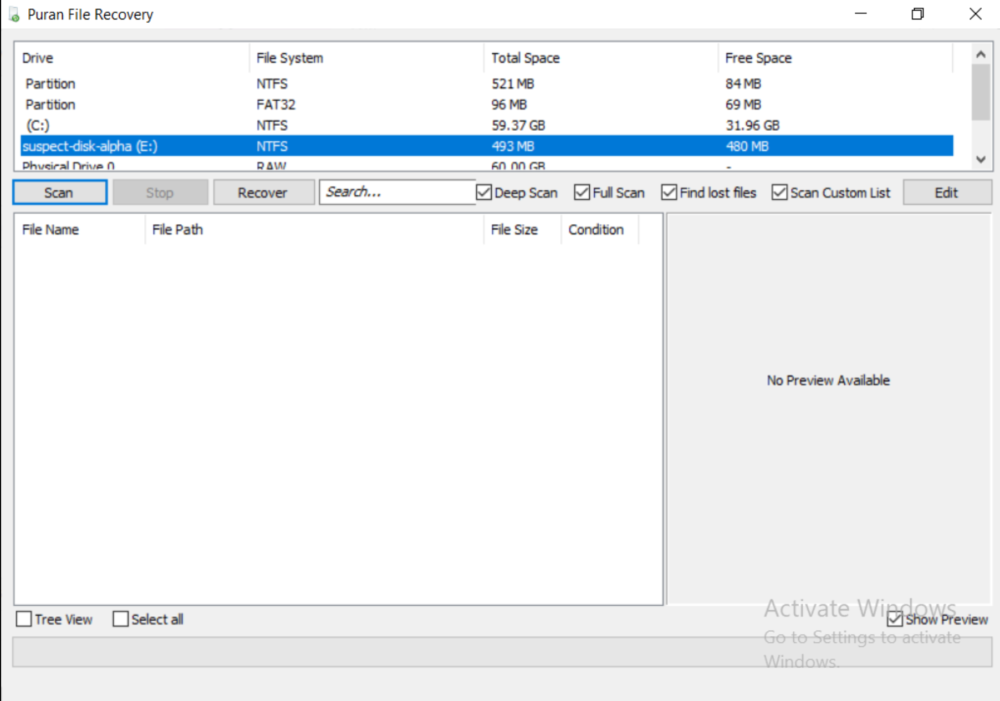

Select **Full Scan** on the same row as **Scan**, then enable options such as **Find lost files**. You can browse the results in the tree view in the lower-left corner.

The scan results show filenames replaced with names beginning with **$I...** and **$R...**, while the file extensions remain intact. This partition uses the NTFS file system. When files are moved to the Recycle Bin, Windows renames them to manage deleted items and avoid name conflicts.

- **$R...** represents the real data. These files are usually a normal size and are the files we want. Right-click and export them to a destination folder; you can then open them from the original path.
- **$I...** represents index/information data. It is a very small metadata file that records the original filename, original path, and deletion time.

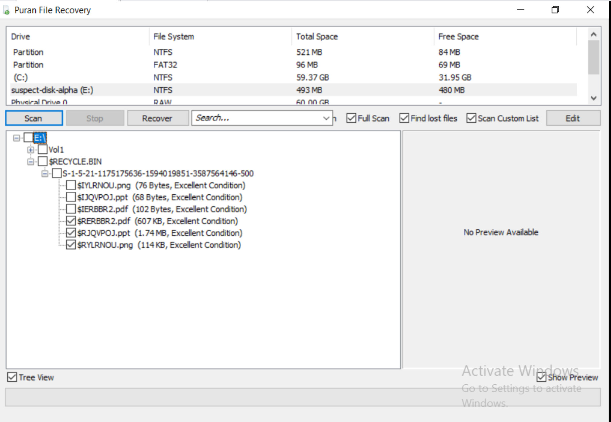

These **$R...** files can then be recovered normally.
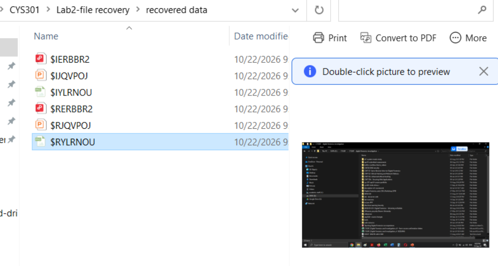
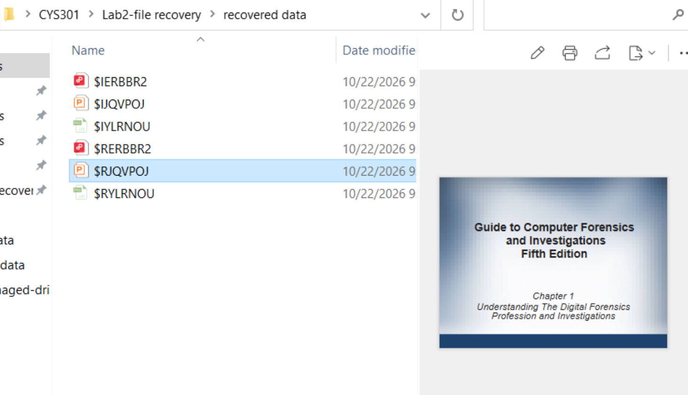
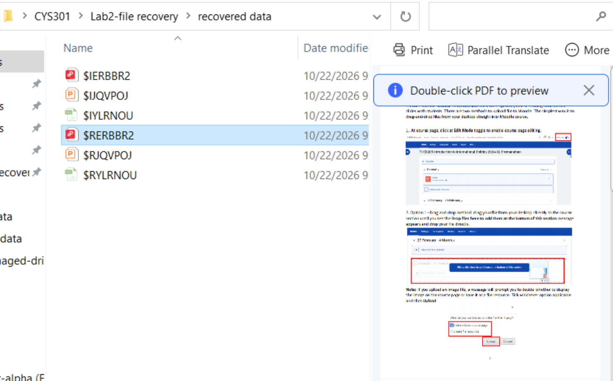

### Deletion using Eraser
Following the same steps, we get the following results:
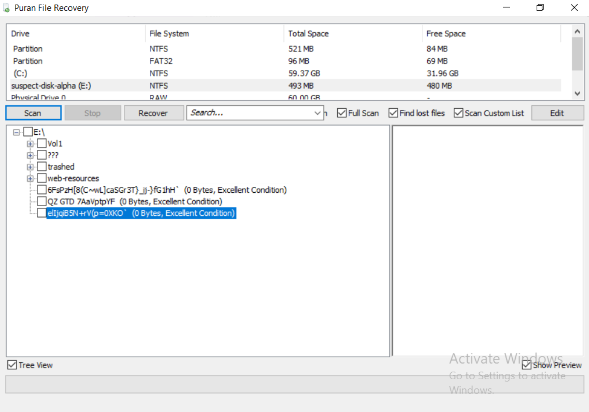

The scanned files appear damaged: their filenames and extensions are garbled, and their sizes are 0 bytes.

## References
[Eraser help](https://eraser.heidi.ie/help/) 
[Puran File Recovery help](https://www.puransoftware.com/File-Recovery.html)
