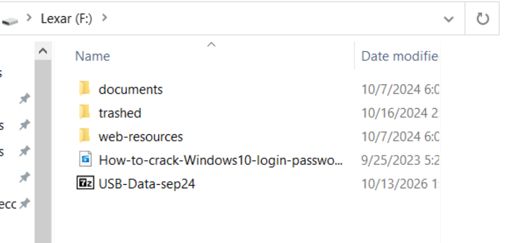
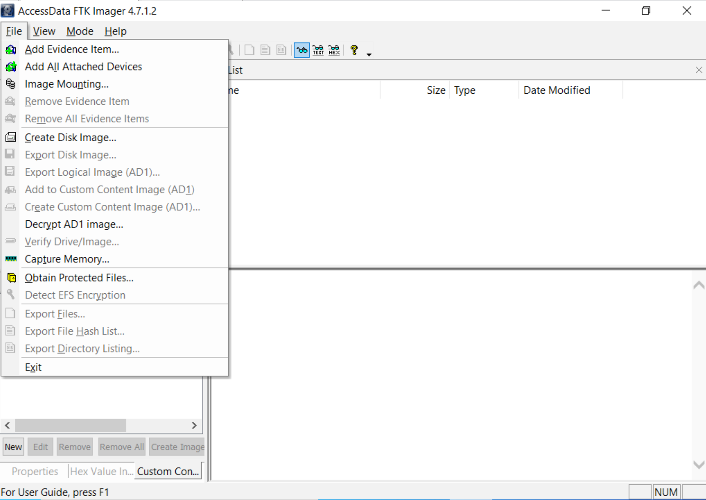
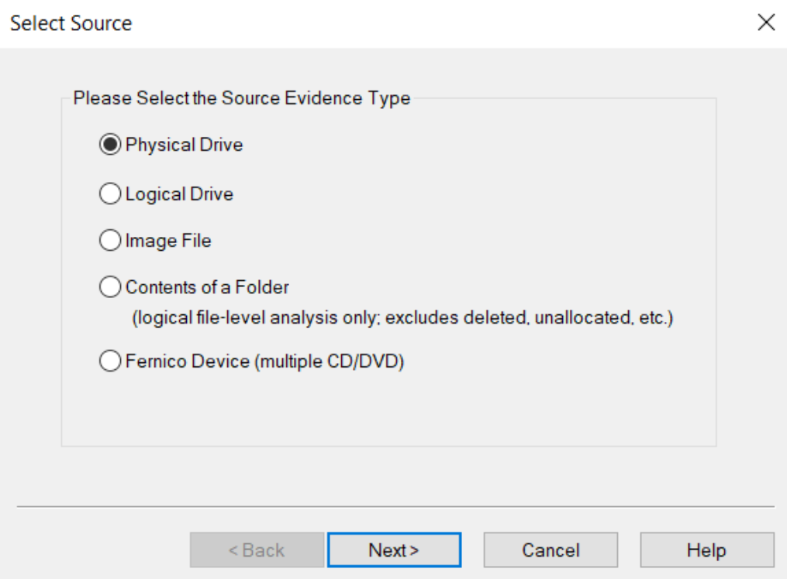
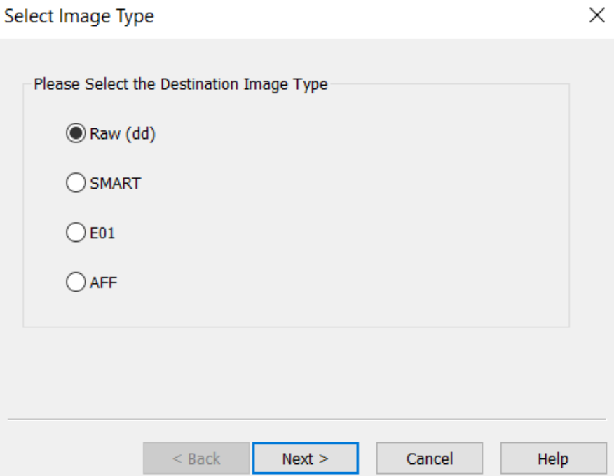
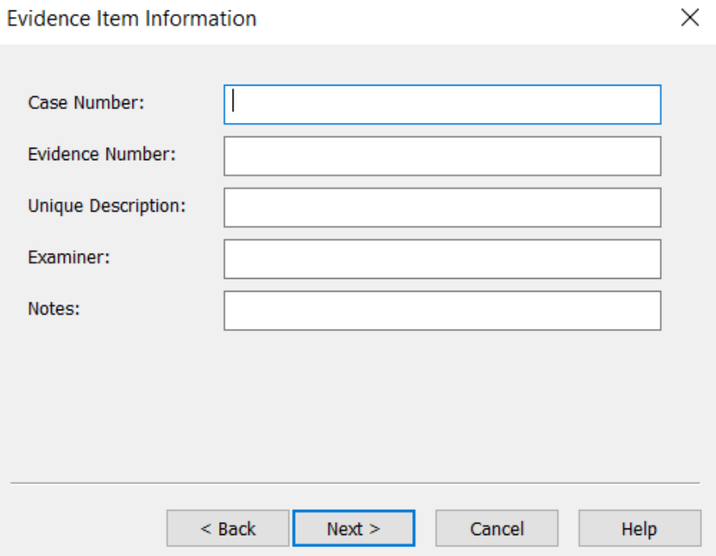
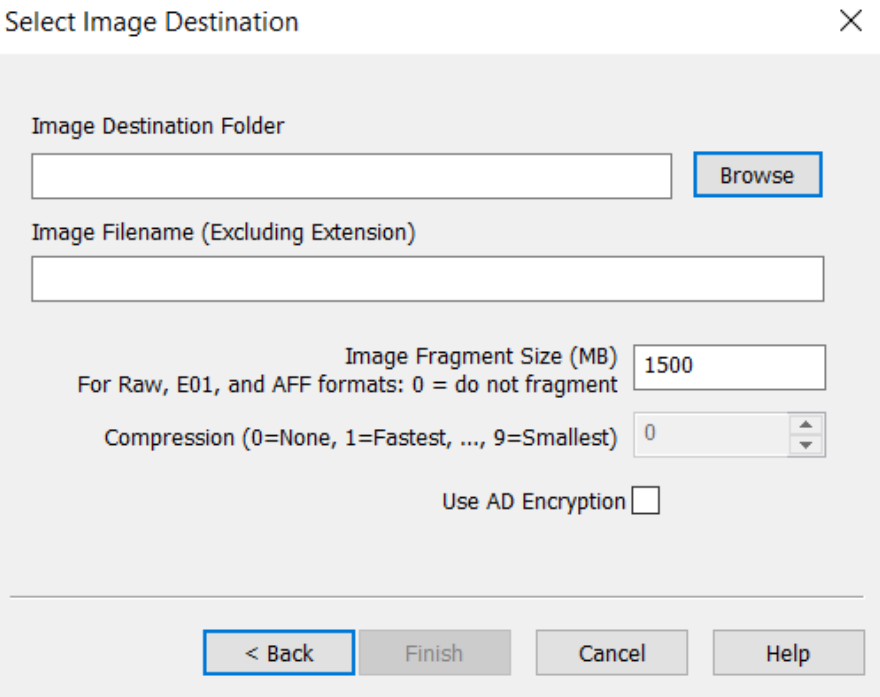
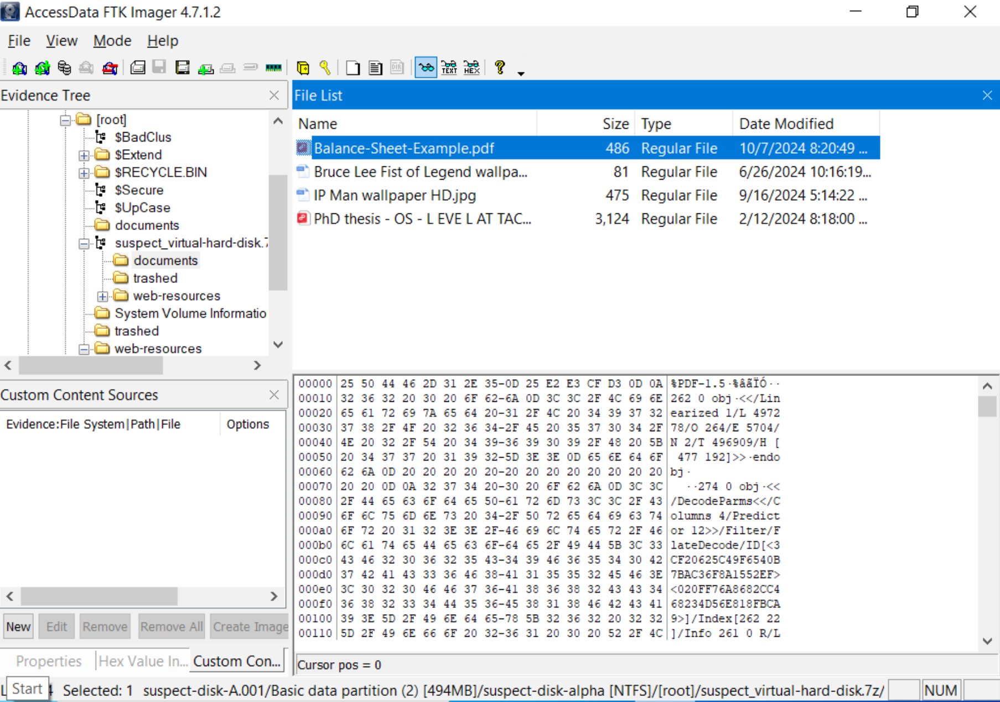

# Lab 3 Notes

Prepare a USB drive in advance and copy the relevant files to it.

## USB Write Protection
Click the link below for detailed instructions; they are not repeated here. 
[Reference link](https://www.ninjaone.com/blog/enable-or-disable-write-protection-windows/)

## Creating a Disk Image

After installing **FTK Imager**, open it and select **File > Create Disk Image** in the upper-left corner.

Select **Physical Drive**.

Choose an image file type. In this example:
  - **Raw (dd)**: an uncompressed raw binary image. The file is larger, but compatibility is excellent.
  - **E01 (Expert Witness Format)**: a container format from AccessData/ExileVision with metadata, compression, and integrity checks (hashes). This is the most commonly used option.
  - **SMART**: a legacy format.
  - **AFF**: a fully open-source format with self-checking capabilities, often used when fault tolerance and highly customizable metadata are required.
  

Then enter the relevant information.

Choose a destination that is **not** the source USB drive, and enter an image name. The default segment size is 1500; 0 means that the image will not be split into segments.

After checking the settings, start the imaging process and wait for it to finish. 
In actual forensic work, **always record and compare the hash values of the source USB drive and the resulting image** to verify that the data was not damaged or altered during imaging and to preserve the chain of custody.

## Analyzing and Extracting from an Image
FTK Imager is not only an imaging tool; it is also an efficient, portable image viewer that requires no installation.

- FTK Imager marks deleted files with an X over their icons.
- The **Evidence Tree** on the left lets you browse the original USB drive and its structure.
- Select a file, right-click it, and choose **Export Files** to save it to a destination path.

FTK Imager has limited image-preview capabilities. For detailed image analysis, use Autopsy. See the next section, [Lab 4](../lab4/index.md).

## References
[USB write protection](https://www.ninjaone.com/blog/enable-or-disable-write-protection-windows/) 
[FTK Imager and Autopsy](https://medium.com/@yogasatriautama/forensic-analysis-flash-disk-with-ftk-imager-autopsy-49b6a2809762)
