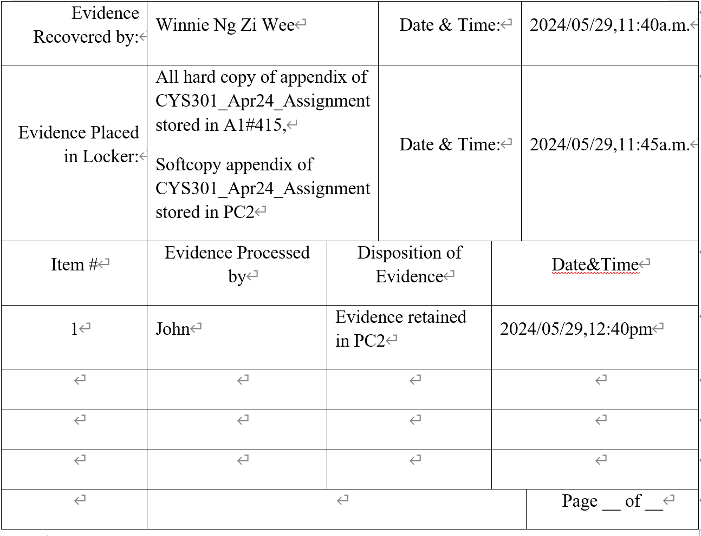
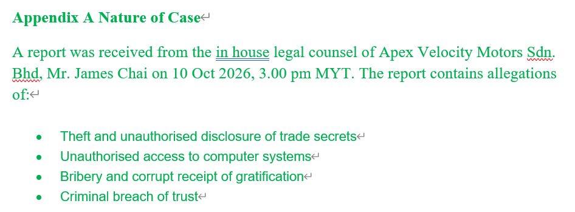
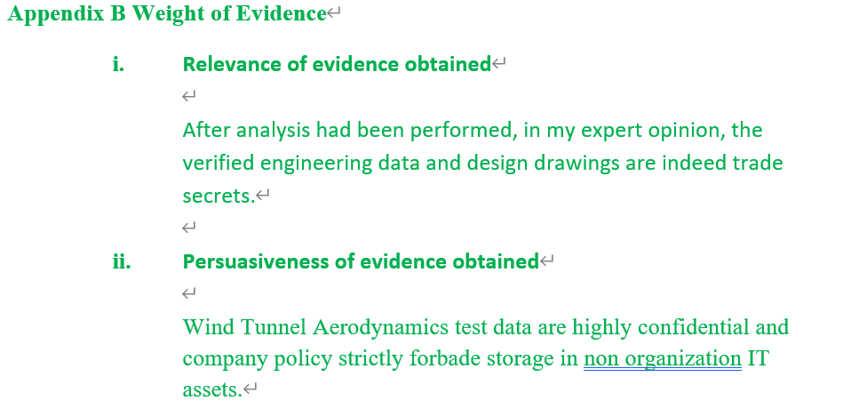
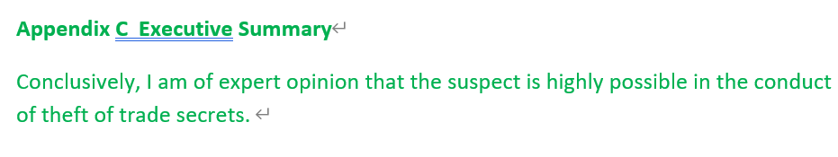

# Lab 5 Notes

This lab covers the Digital Forensics Evidence Form and the Chain-of-Custody Form.

## Digital Forensics Evidence Form

**Section A: Physical Evidence**  
Record the evidence number, device description, vendor, model/serial number, source or location, and condition.

**Section B: Digital Evidence**  
Record the digital evidence number, source device, file path, file ownership, description, and notes. Specify which physical evidence item it came from.

**Evidence recovery and findings**

### Appendices

- **Appendix A: Nature of Case**  
  Use the case brief and reporting or transfer information. State the case source, date, and main allegations neutrally. Distinguish allegations from established facts.
  
- **Appendix B: Weight of Evidence**  
  For each physical or digital item, assess its relevance to the investigative questions and the reliability and persuasiveness of the results.
  - **Relevance:** How the evidence relates to the case.
  - **Persuasiveness:** The basis for the assessment and its limitations.
  
- **Appendix C: Executive Summary**  
  Summarize the preceding material without adding findings. State what was examined and what the findings support.
  

Keep facts separate from interpretation. Do not present the form as a finding of guilt.

## Description of Evidence Form

Record the item number, quantity, and description (model, serial number, condition, marks, and scratches).

## Chain-of-Custody Form

For every transfer, record the date, released-by and received-by details, location, and action taken.
