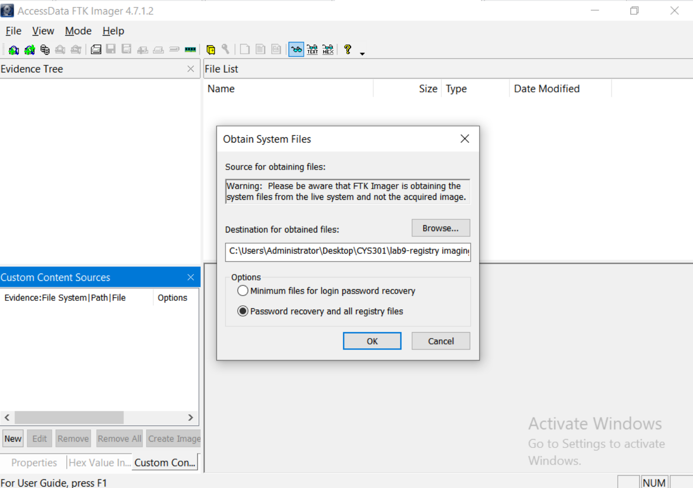
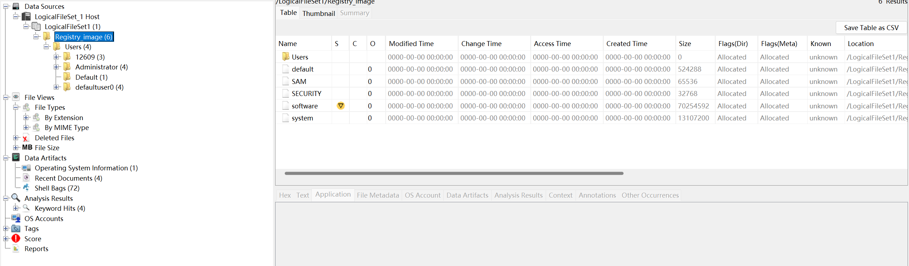
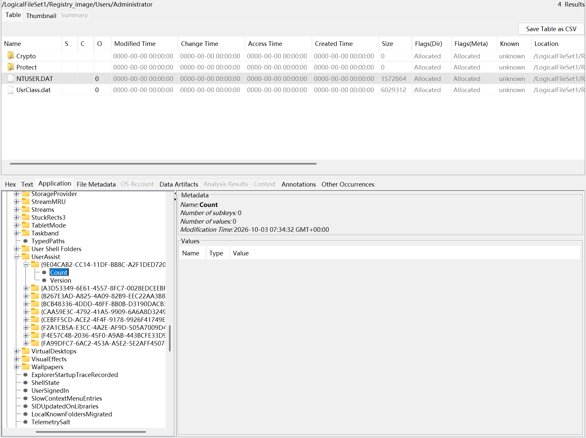

# Windows Registry Analysis

Common topics in Windows Registry analysis.

Press **Win + R** and enter regedit to open Registry Editor.

## Common Keys

1. HKCU\Software\Microsoft\Windows\CurrentVersion\Explorer\ComDlg32\OpenSavePidlMRU

   Shows files or locations a user accessed through an Open or Save dialog, for example, by choosing **File → Open** in Word. It commonly retains the ten most recent entries. Files opened or saved through Microsoft Office are not recorded here.

2. HKCU\Software\Microsoft\Windows\CurrentVersion\Explorer\RecentDocs

   Records recently opened or accessed files. Folder contains information about folders holding recently opened files. NetHood relates to LAN shared folders and may indicate recent access to a shared folder.

3. HKLM\SYSTEM\CurrentControlSet\Services\Tcpip\Parameters\Interfaces\

   May show network configurations, IP addresses, DHCP, and DNS settings previously used by the computer. Some information may remain after disconnection.

4. HKCU\Software\Microsoft\Windows\CurrentVersion\Explorer\UserAssist

   Contains information about programs run by the user and, for some entries, run counts or timing data. Names are commonly encoded with ROT13.

   UserAssist alone does not provide a precise event timestamp.

5. HKEY_LOCAL_MACHINE\SYSTEM\CurrentControlSet\Enum\USBSTOR

   Lists USB storage devices previously connected to the computer. A serial number is not necessarily a unique hardware serial; it may be an identifier derived from the USB port and device characteristics.

6. HKEY_LOCAL_MACHINE\SOFTWARE\Microsoft\Windows NT\CurrentVersion\NetworkList\Profiles

   Shows networks the computer has connected to or recognized, but does not establish its physical location.

   ~~~text
   ProfileName        = Starbucks_WiFi
   DateCreated        = first connection
   DateLastConnected  = most recent connection
   ~~~

7. HKEY_CURRENT_USER\Software\Microsoft\Internet Explorer\TypedURL

   Contains URLs the user manually typed into the Internet Explorer address bar.

## Registry Forensics

On the suspect device, use a write blocker to transfer data to a forensic workstation, then create an image to avoid altering the evidence.

1. **Locate the hives:** HKEY_LOCAL_MACHINE\System\CurrentControlSet\Control\HiveList
2. **Create an image:** Save the Registry hive files separately and create an image from them.

   

3. **Open the image in Autopsy:** Enable the views for hidden files and protected files.

   

   Select **Logical Files** as the data source. The saved Registry hive files should be visible.

4. **Inspect UserAssist:** UserAssist\{GUID}\Count stores records of programs launched through the Windows GUI and shortcut activity. The entries are ROT13-encoded.

   

FTK Imager's **Obtain System Files** operation collects system files from the computer running the tool; it does not collect them from an evidence image. If this distinction is missed, data from the forensic workstation may be mistaken for evidence.
