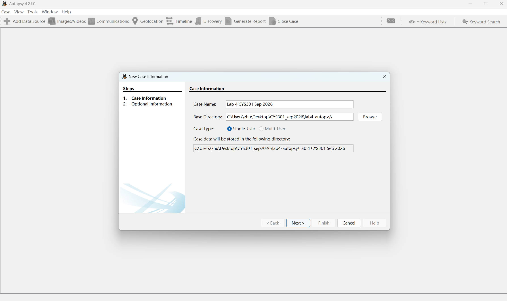
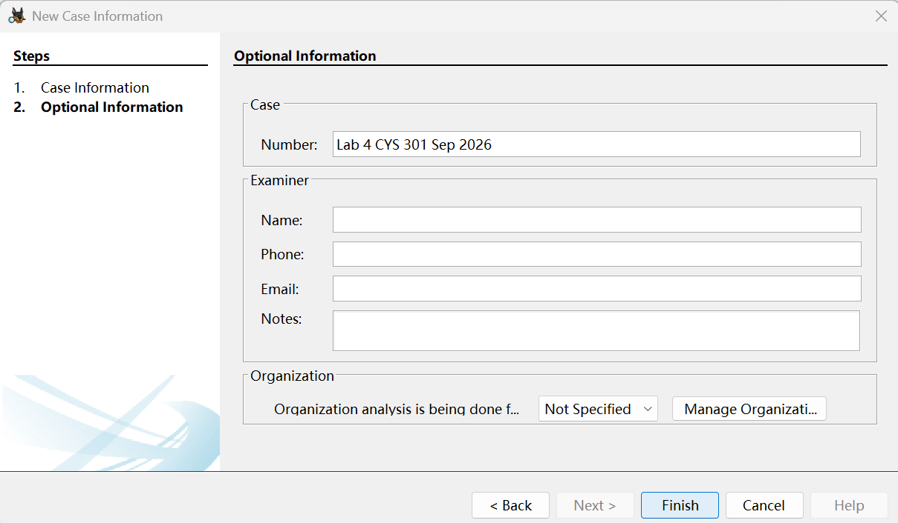
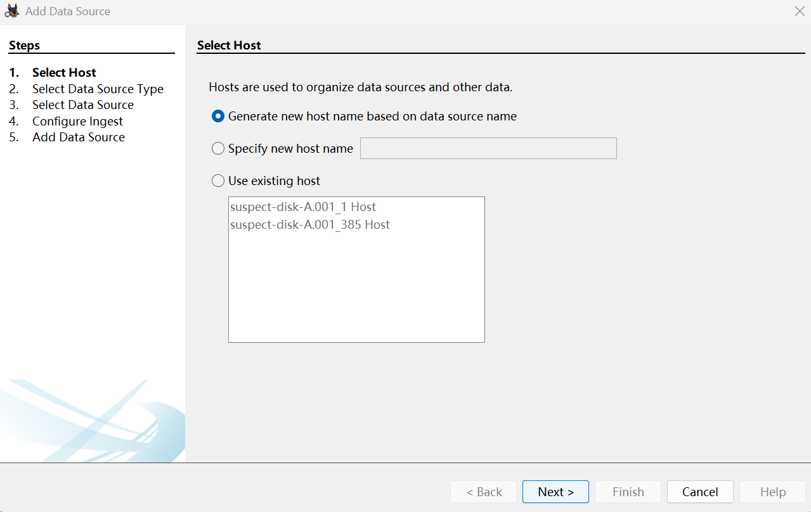
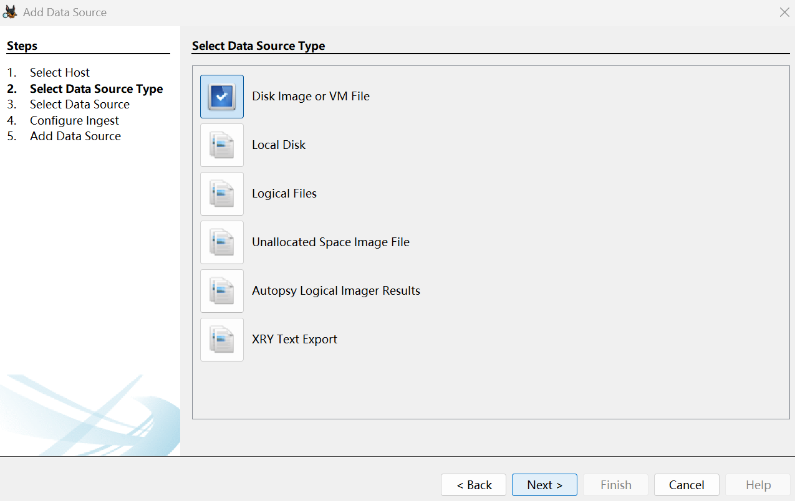
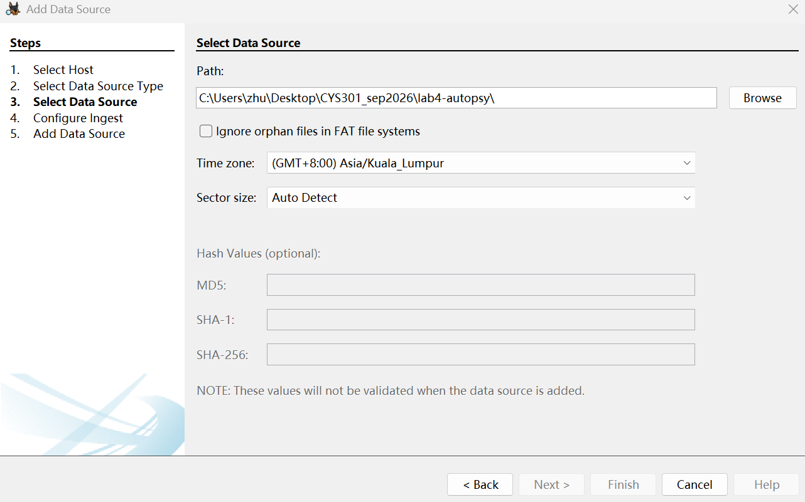
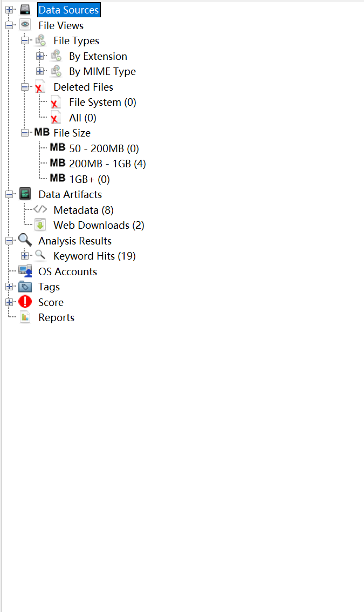
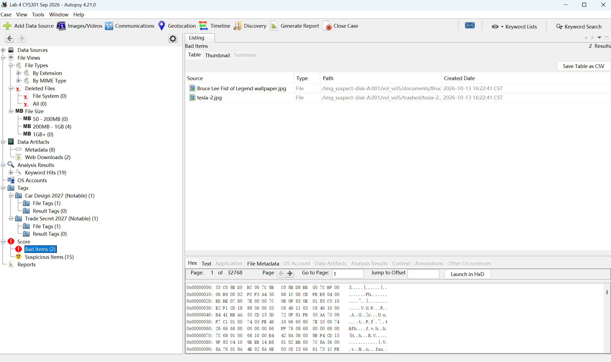
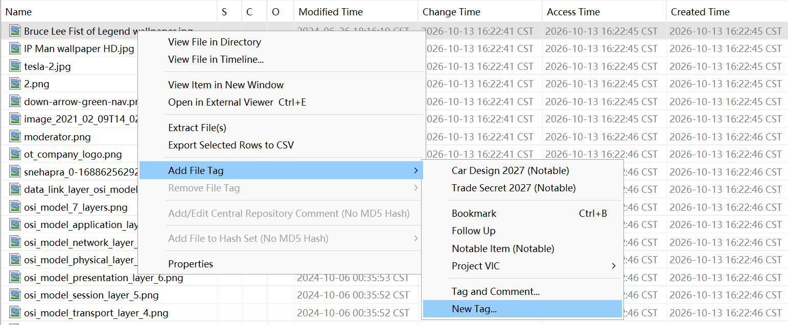
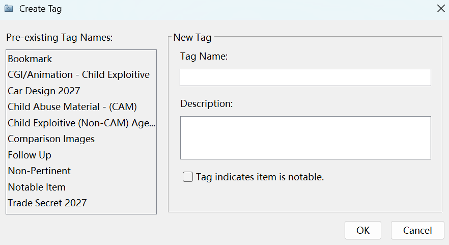

# lab4实验笔记

安装好Autopsy并放置好要分析的001镜像文件 
autopsy需要在宿主机运行否则有latency

## 新建案例
左上角Case>NewCase(Ctrl+N)，填写相关信息，选择存放案例文件夹的路径 
*注意：路径中请勿包含中文字符或特殊符号，且目标盘符需预留至少 50GB 以上空间。*

Optional Information中按照私人需求填写信息

## 加入数据源
选择Host，一般是建新的

选择数据源类型
  - Disk Image or VM File：磁盘镜像（如 .dd、.raw、.E01、VMware 虚拟磁盘等）。
  - Local Disk：直接分析本地物理驱动器（建议仅在非核心取证时使用）。
  - Logical Files：特定文件夹或逻辑文件集合。
  

选择001文件路径和时区 
*不要忽略孤儿文件，取证追求**蛛丝马迹***

关于Configure Ingest摄取模块，根据需求勾选：
  - Embedded File Extraction：提取压缩包或Office文档内的嵌入文件。
  - Keyword Search：启用关键词批量搜索。
  - Hash Lookup：利用已知哈希库（如 NSRL）匹配或过滤已知系统文件。
  - Exif Parser：提取图片的 GPS、拍摄时间等元数据。
  - Recent Activity：解析浏览器历史、下载记录、USB 挂载历史、最近文档等。
一般情况下默认即可

## 详细分析方法
Tree视图：
  - Data Sources（数据源视图）：按目录树结构浏览原始文件系统（NTFS、FAT、Ext4、HFS+ 等）。
  - File Views（视图分类）：
	  - File Types：按文件类型分类查看（如图片、视频、文档、压缩包、可执行程序）。
	  - Deleted Files：专门列出已被删除但可以尝试恢复的文件（绿色或带有标记的文件通常可完整或部分恢复）。
    - File Size：根据文件大小快速定位文件类型，如视频类一般很大
	- Data Artifacts（数据产物）：
    - Metadata：查看文件的详细元数据。
    - Web Downloads：自动提取目标设备上所有浏览器（Chrome, Edge, Firefox 等）的下载历史。
  - Analysis Results（分析结果）：
	  - Keyword Hits：显示你在配置模块中设定的关键词搜索匹配结果。
  - OS Accounts：列出该操作系统中存在过的所有用户账户
  - Tags：标记管理区。发现关键线索后可以右键该文件选择Add Tag（例如标记为 "Notable" 值得注意的，或 "Follow Up" 需后续跟进）。
	- Score: 你可以看到你标记的文件。其次Autopsy也会根据内置的规则给文件打分。
  - Reports: 产出分析报告

  ### Score模块
  

  标记过程
  

  填写信息
  

## 生成分析报告
顶部**Generate Report**按钮即可生成报告，按照要求勾选分析项并保存为HTML文件即可

## Reference
[autopsy-help](https://sleuthkit.org/autopsy/docs/user-docs/4.23.0/)