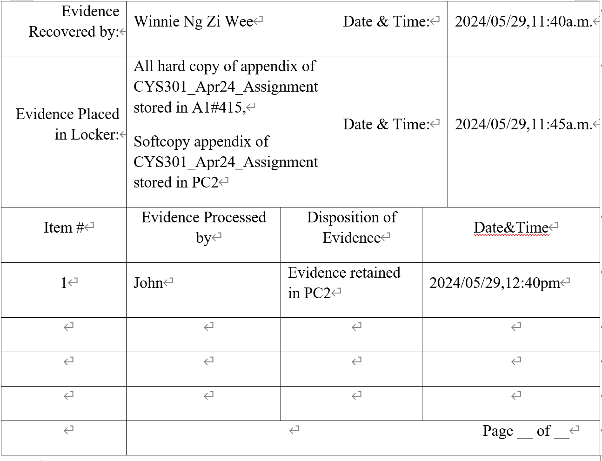
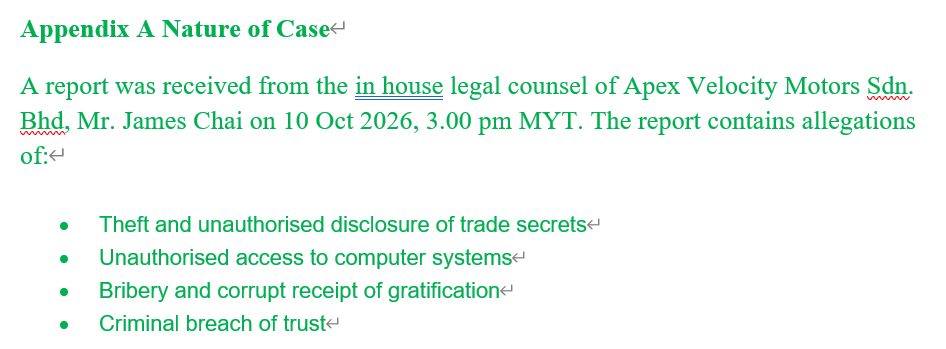
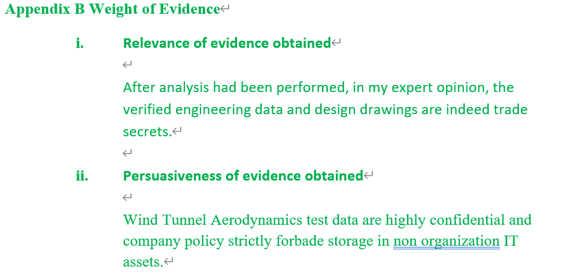

# lab5实验笔记

本实验为撰写evidence form与Chain-of-Custody form 

## Digital Forensics Evidence Form 
**Section A 实体证据** 
证物编号，设备描述，厂商(Vendor name)，型号/序列号，来源地点和状态

**Section B 数字证据** 
数字证物编号，来源设备，文件路径，文件归属，描述和备注: 写明**来自哪个实体证物**

**证据处置** 

**Appendix** 
 - **Appendix A**: Nature of Case 案件性质 
  依据案件简报、报案/移交信息。交代案件来源、日期、涉及的主要指控，保持中性，注明是指控而非已证实的事实
  

 - **Appendix B**: Weight of Evidence 证据分量 
  根据实际证物(实体/数字)，分别评价它和调查问题的关联性，以及结果有多可靠，多有说服力。 
    - Relevance: 证据与案件联系 
    - Persuasiveness: 支持判断的依据与限制 

    

 - **Appendix C**: Executive Summary 执行摘要 
  对上述的总结，不添加新发现。检查了什么、发现支持什么。
  

注意把事实和解释分开，**避免**成为对嫌疑人的定罪判断

## Description of evidence Form 
编号，数量，item描述(Model, Serial #, Condition, Marks, Scratches)

## Chain-of-Custody Form 
编号，记录每次移交的记录日期、移交人(Released by)与接收人(Received by)、地点和处理动作。