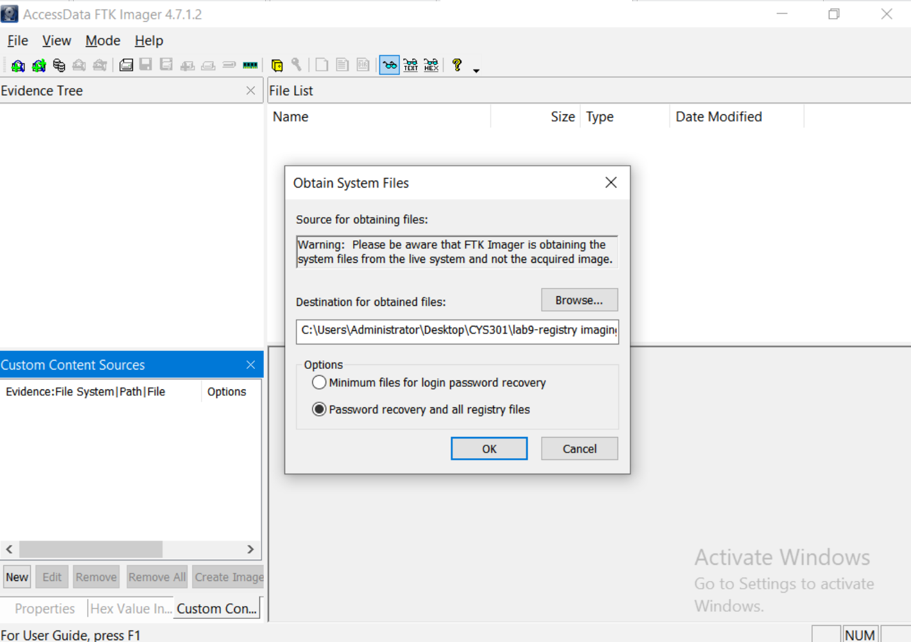
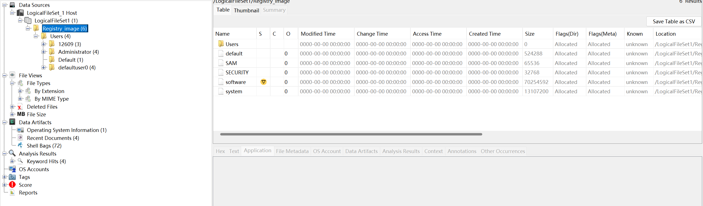
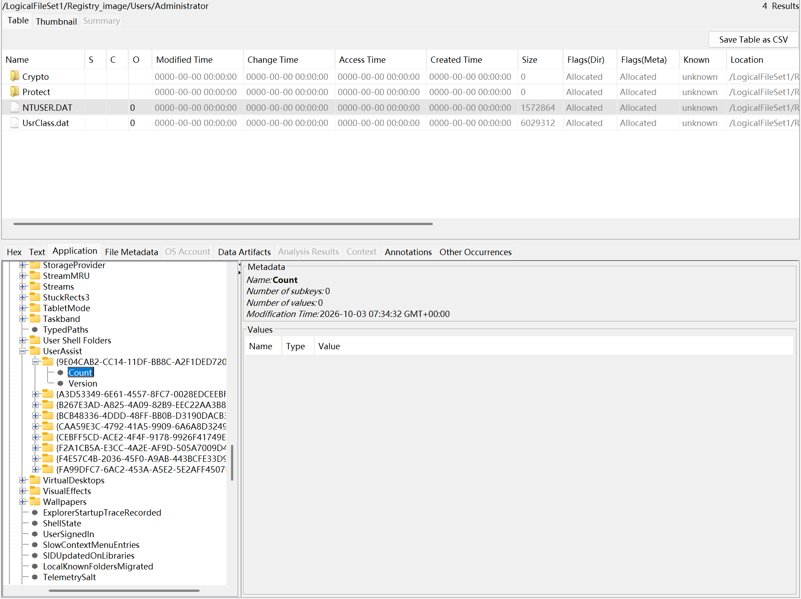

# Windows Registry 注册表

Windows注册表分析常见知识点

win+r唤出`regedit`

## 常见键分析
1. HKCU\Software\Microsoft\Windows\CurrentVersion\Explorer\ComDlg32\OpenSavePidlMRU

用户曾经通过打开/保存**对话框**访问哪些文件/位置，如经Word>File>Open打开<br>
*打开的是最近10个，Microsoft Office打开/保存的文件不记录在这里。

2. HKCU\Software\Microsoft\Windows\CurrentVersion\Explorer\RecentDocs

最近打开/访问的文件。其中Folder存的是最近打开文件所在的folder信息，而NetHood存的是LAN shared folder，可以查看用户最近是否访问过共享文件夹

3. HKLM\SYSTEM\CurrentControlSet\Services\Tcpip\Parameters\Interfaces\

这台Windows曾使用过哪些网络配置、IP、DHCP、DNS等，断网后仍可能保留

4. HKCU\Software\Microsoft\Windows\CurrentVersion\Explorer\UserAssist

用户运行过哪些程序，以及部分运行次数/时间信息。常用ROT13编码

注意，UserAssist本身不能直接给你一个明确的事件时间。

5. HKEY_LOCAL_MACHINE\SYSTEM\CurrentControlSet\Enum\USBSTOR

这台电脑曾经连接过哪些USB存储设备。其中Serial Number不一定是真正的硬件唯一序列号，可能是根据USB port + device characteristics生成的ID。

6. HKEY_LOCAL_MACHINE\SOFTWARE\Microsoft\Windows NT\CurrentVersion\NetworkList\Profiles

电脑曾经连接/识别过哪些网络，但是不可以断言物理位置

```text
ProfileName        = Starbucks_WiFi
DateCreated        = 第一次连接
DateLastConnected  = 最近一次连接
```

7. HKEY_CURRENT_USER\Software\Microsoft\Internet Explorer\TypedURL

用户曾在IE地址栏**手动输入**过哪些网址

## 注册表取证

注册表取证分析是Digital Forensics的重要一环，在suspect device上使用write-protect设备传输到取证工作站，再制作镜像，不破坏现场证据

1. 找到Hive，即registry数据库
`HKEY_LOCAL_MACHINE\System\CurrentControlSet\Control\HiveList`

2. 制作Image：将Registry Hive文件单独保存下来制作为镜像


3. 使用autopsy查看镜像文件，记得打开隐藏文件和受保护文件视图


    数据源为Logical Files

    可以看到把Registry Hive文件保存下来了

4. 查看UserAssist键
`UserAssist\{GUID}\Count 保存了用户通过 Windows 图形界面（GUI）启动程序、访问快捷方式等活动的记录。该处被ROT13加密


FTK Imager的`Obtain System Files`操作是在你自己的电脑上获取系统文件，而不是从evidence image获取；如果忽略这一点，甚至可能把取证工作站自己的数据当成证据。